# Revisão completa — novembro de 2026

> Diagnóstico e proposta, sem mudança de código, banco ou configuração. Feito em 2026-11-03 sobre o commit `7464a6a` (main). Os únicos arquivos novos são este relatório, os prints em `docs/img/revisao/` e cinco diagnósticos SQL em `supabase/diagnostics/`.

## 1. Resumo executivo

1. **Está bom:** a base é sólida. Lint, formatação, tipos, 160 testes e build passam. Há RLS em todas as tabelas, cascata ao apagar a conta, BYOK correto, backup cifrado funcionando desde hoje e um agendador vivo (último tick há 4 min, 55 respostas 200 seguidas).
2. **Está bom:** as telas públicas tiram 96–100 no Lighthouse e não têm violações no axe. As regras de feriados, check-in e preços são lógica pura e testada.
3. **Está frágil:** os avisos. Um aviso fica registrado mesmo sem ser entregue, e já existem 2 avisos registrados com canal "nenhum". Um único perfil com fuso inválido derruba o tick de todo mundo. Editar uma passagem reenvia avisos e zera o check-in.
4. **Está frágil:** o monitor de preços. A cobertura dentro da janela de horário é de 31% (SP→RJ) e 0% (RJ→SP). Do jeito que está, o monitor não cumpre a função.
5. **Está frágil:** só 35% das linhas têm teste. Telas, actions, rotas, tick e repositórios estão em 0%. Não há registro de erros em produção.
6. **Fato que muda a prioridade:** há **0 passagens cadastradas** em produção. A funcionalidade 1 nunca rodou com dado real, e importar do Gmail é o que destrava isso.
7. **Fato novo:** existe uma **2ª conta**, criada hoje entre 01:29 e 01:55 UTC. Ela não tem nenhum canal de aviso, tem monitor e é a origem dos avisos "nenhum". Confirme se é sua.
8. **Maiores riscos:** (1) avisos perdidos ou duplicados, (2) um usuário derrubar o agendador de todos, (3) fonte de preços inadequada, (4) cadastro aberto num app pessoal, (5) erros invisíveis em produção.
9. **E-mail (prioridade):** o caminho recomendado para a v1 é **Gmail API com `gmail.readonly`**, num projeto Google seu em modo de uso pessoal, varrendo pelo `pg_cron` que já existe. A primeira varredura custa **menos de US$ 2** com Haiku 5.5 e o mês, centavos.
10. **Próximo passo sugerido:** Bloco 0 (ganhos rápidos, cerca de 2 dias), depois o piloto grátis de outra fonte de preços em paralelo com o Bloco 2 (importação do Gmail).

## 2. Como foi feita (evidência)

| Fonte            | O que rodou                                                                                                                                 | Resultado                                                                                                                    |
| ---------------- | ------------------------------------------------------------------------------------------------------------------------------------------- | ---------------------------------------------------------------------------------------------------------------------------- |
| Código           | Leitura de `src/lib`, `src/app` (telas, actions, rotas), `supabase/migrations`, `scripts/`, `.github/workflows`                             | Cerca de 13,8 mil linhas                                                                                                     |
| Next 16.4        | `node_modules/next/dist/docs`: caching, Cache Components, autenticação com Cache Components, CSP, PWA                                       | Base dos achados F1, S3 e F8                                                                                                 |
| Checagens locais | `npm ci`, `lint`, `format:check`, `typecheck`, `test` (TZ=UTC), `build`                                                                     | Todas passam. 21 arquivos e 160 testes. Build em 18 s, 28 rotas                                                              |
| Cobertura        | `vitest --coverage` (v8), sem alterar o `package.json`                                                                                      | 35,0% das linhas, 28,6% dos ramos (tabela na seção 7)                                                                        |
| Banco (Actions)  | `estado-schema`, `uso-banco`, `avisos`, `piloto-precos` e os novos `rls-policies`, `agendador`, `storage-retencao`, `indices-uso`, `canais` | Só nomes, contagens e erros técnicos. Execuções 41562821555…41563208053                                                      |
| Front-end        | `next start` local + Playwright (390 px e 1280 px, claro e escuro), Lighthouse 12, axe 4                                                    | Telas logadas renderizadas contra um **Supabase falso local com dados fictícios** (nenhum dado real, nenhuma mudança no app) |
| Pesquisa         | WebSearch (o acesso direto a developers.google.com, serpapi.com, duffel.com etc. está bloqueado nesta sessão)                               | Cada fato tem fonte na seção 9. O que não deu para confirmar está marcado como "não confirmado"                              |

## 3. O que o banco de produção mostra hoje (sem dados pessoais)

| Item                                | Valor                                                                                                                                                                 | Leitura                                                                                                                |
| ----------------------------------- | --------------------------------------------------------------------------------------------------------------------------------------------------------------------- | ---------------------------------------------------------------------------------------------------------------------- |
| Usuários / perfis                   | 2 / 2                                                                                                                                                                 | O backup das 01:29 UTC tinha 1 usuário. A 2ª conta é de hoje                                                           |
| Canais por perfil                   | Perfil A: e-mail ligado, chave Resend e Anthropic. Perfil B: nenhuma chave, nenhum canal de fato (push e Telegram marcados, mas sem assinatura nem chat), com monitor | B gera avisos que ficam registrados como "nenhum"                                                                      |
| Passagens                           | **0** (`bookings` e `flights` vazias)                                                                                                                                 | Funcionalidade 1 sem uso real                                                                                          |
| Monitores                           | 6 linhas (2 da ponte aérea + feriadões)                                                                                                                               | —                                                                                                                      |
| Piloto Travelpayouts                | CGH→SDU: 93,8% das datas com preço e 31,3% na janela. SDU→CGH: 68,8% e **0%**                                                                                         | 1 checagem por rota até agora. Leitura final em 09/11                                                                  |
| Avisos                              | `holiday-monitor` por e-mail: 6. `long-weekend` por e-mail: 2. `long-weekend` sem canal: **2**                                                                        | O padrão do incidente de 04/11 continua (achado A1)                                                                    |
| Agendador                           | Job `*/5`, ativo. 66 execuções em 24 h. HTTP: 55×200 e 11×404 (20:30–21:20 de 02/11, antes do deploy)                                                                 | Saudável hoje. O vigia nunca precisou agir                                                                             |
| Tick (soma das respostas guardadas) | 18 avisos enviados, 2 checagens de preço, 3 falhas de checagem, 0 erros na etapa de preços e na retenção                                                              | As 3 falhas não deixam rastro além da contagem (achado E1)                                                             |
| Storage                             | **Nenhum bucket e nenhum objeto**                                                                                                                                     | Nenhum original é guardado (achado D2)                                                                                 |
| Banco                               | 12,1 MB (2,4% de 500 MB)                                                                                                                                              | Folga enorme. `reltuples` vem zerado porque não houve `analyze`; o `indices-uso.sql` usa `n_live_tup`, que é confiável |
| RLS                                 | Ligado nas 15 tabelas do `public`. `app_config` e `app_migrations` sem policy (só service role). `flights` confere o dono da reserva                                  | Correto (detalhes em S4/S5)                                                                                            |
| Backup                              | Execução 41560040573 (hoje, 01:29 UTC): modo `backup`, cifrado, artefato de 4,7 KB que expira em 01/12                                                                | O item 1 dos "Próximos passos" do STATUS já foi feito. Falta atualizar o documento                                     |

## 4. Fluxos ponta a ponta

| Fluxo                                     | Situação                          | Onde quebra ou o que está meio pronto                                                                                                                                      |
| ----------------------------------------- | --------------------------------- | -------------------------------------------------------------------------------------------------------------------------------------------------------------------------- |
| Login Google → perfil                     | Funciona                          | Cadastro aberto (D4). O login também aceita sessão pelo fragmento da URL (S9)                                                                                              |
| Passagens: colar texto, print/PDF, manual | Funciona                          | **Editar quebra** (A3). Ida sem volta não gera aviso (X3). Encaminhar e-mail (M7) não existe, mas a página inicial promete (F11)                                           |
| Regras e alertas                          | Funciona                          | "Hoje" é calculado em UTC: depois das 21h em Brasília já é amanhã (E6)                                                                                                     |
| Avisos: e-mail (Resend), push, Telegram   | Funciona no caminho feliz, frágil | Registra sem entregar (A1). Um perfil derruba todos (A2). Sem trava contra duplicar (A5). Resend Free: 100/dia, 1 e-mail por aviso (A9)                                    |
| Monitor de preços                         | Meio pronto                       | Fonte sem cobertura na janela (P1). Erro do provedor conta como "sem dado" (P2). Monitor grande estoura o tempo do tick (A4). SerpApi e Duffel nunca rodaram com dado real |
| Feriados e feriadões                      | Funciona                          | O feriadão usa sempre as rotas e janelas da ponte aérea do dono (X5)                                                                                                       |
| Agendador: pg_cron, vigia, retenção       | Funciona hoje                     | Vigia público sem `CRON_SECRET` (A6). Vigia cego se o Supabase cair (A7). Retenção roda por último e marca o dia antes de apagar (A8)                                      |
| Backup e restauração                      | Funciona (desde hoje)             | Sem alerta de backup velho. A restauração real nunca foi feita. O agendamento morre após 60 dias sem commit (D3)                                                           |

## 5. Tabela de achados

Gravidade: **crítico** (perde dados ou expõe dados agora), **alto** (quebra uma funcionalidade-chave ou pode derrubar o sistema), **médio**, **baixo**. Esforço: **P** até 1 dia, **M** de 1 a 3 dias, **G** mais de 3 dias. Não encontrei nenhum achado crítico.

### Agendador e avisos

| id  | gravidade | impacto para você                                                                                                                                                                                                                          | esforço | evidência                                                                                                                                                                                                                   | recomendação                                                                                                                                                                                                                     |
| --- | --------- | ------------------------------------------------------------------------------------------------------------------------------------------------------------------------------------------------------------------------------------------ | ------- | --------------------------------------------------------------------------------------------------------------------------------------------------------------------------------------------------------------------------- | -------------------------------------------------------------------------------------------------------------------------------------------------------------------------------------------------------------------------------- |
| A1  | alto      | Um aviso de check-in pode se perder em silêncio se o Resend falhar: ele fica registrado e nunca é reenviado. Já aconteceu (incidente de 04/11) e continua: há 2 avisos com canal "nenhum"                                                  | P       | `src/lib/jobs/tick.ts:250-251` ("Registra mesmo sem canal configurado"). Nos avisos de preço: `tick.ts:200-202`. Diagnóstico `avisos.sql`: `long-weekend` com canal "nenhum" = 2                                            | Registrar como entregue só se pelo menos 1 canal funcionou, ou se o usuário não tem canal nenhum (e mostrar "sem canal" na tela). Caso contrário, guardar tentativas e erro e tentar de novo (até 6 vezes, com espera crescente) |
| A2  | alto      | Com cadastro aberto, qualquer pessoa pode parar os avisos de todos: basta gravar um fuso inválido no próprio perfil pela API pública. Uma falha de rede no Telegram tem o mesmo efeito                                                     | P       | `supabase/migrations/20261029000000_init.sql:25` (`timezone` sem CHECK) e `:41-42` (update de qualquer coluna). `tick.ts:173` chama `quietFor` fora de try. `src/lib/notify/channels.ts:9-14` (`fetch` sem try nem timeout) | `try/catch` por usuário e por aviso no laço. CHECK de fuso válido no banco. Timeout de 10 s no Telegram e no push                                                                                                                |
| A3  | alto      | Editar qualquer campo de uma passagem (até a observação) reenvia os avisos de check-in, feriado e conflito, inclusive o de 24h que fura a janela de silêncio. Também desmarca "check-in feito" e "cheguei por outro meio"                  | P–M     | `src/lib/trips/repo.ts:70-74` apaga e recria os trechos com ids novos. Chaves `checkin-24h:${f.id}` em `src/lib/notify/events.ts:41,49`. `src/lib/trips/draft.ts:210-220` não leva `checkin_done`                           | Mandar o id de cada trecho no formulário e atualizar só o que mudou, preservando `checkin_done` e `ignore_missing_leg`. Tudo numa transação (função SQL)                                                                         |
| A4  | alto      | Um monitor com muitas datas (a tela permite até 52 semanas) faz o tick passar de 60 s. A Vercel corta, o monitor fica vencido para sempre e volta em todo tick, gastando cota. Avisos de preço e retenção, que rodam depois, não acontecem | M       | `src/lib/prices/jobs.ts:10` (`MONITORS_PER_TICK = 5`, em série). `src/app/api/jobs/tick/route.ts:5` (`maxDuration = 60`). `next_check_at` só avança no fim (`src/lib/prices/repo.ts:265-392`)                               | Reservar o monitor no início (update condicional), orçamento de tempo de cerca de 35 s por tick, avisos e retenção **antes** das checagens, limite de datas por monitor (≤ 60)                                                   |
| A5  | médio     | Avisos podem sair em dobro: não há trava entre ticks, vigia e "Verificar agora", e erros de leitura e escrita do registro são ignorados                                                                                                    | M       | `tick.ts:231-239` (lê o log sem checar `error`). `tick.ts:213-219` (upsert sem checar). Envia antes de gravar                                                                                                               | "Reservar antes de enviar": insert com `status='pending'` e `on conflict do nothing returning`. Só quem reservou envia                                                                                                           |
| A6  | médio     | Sem `CRON_SECRET`, qualquer pessoa pode chamar o vigia. Com o agendador parado, chamadas em paralelo rodam vários ticks ao mesmo tempo                                                                                                     | P       | `src/app/api/jobs/watchdog/route.ts:25-27` (só confere se houver segredo). `:38-39` (lê e depois grava). Diagnóstico `agendador.sql`: o vigia nunca rodou                                                                   | Exigir `CRON_SECRET` (você cria na Vercel) e trava atômica no `app_config`                                                                                                                                                       |
| A7  | médio     | Se o Supabase pausar ou cair, o vigia não consegue avisar: ele lê a configuração, o seu e-mail e a sua chave Resend do próprio banco                                                                                                       | P       | `watchdog/route.ts:31` (`getConfig` sem try). `:52-59`                                                                                                                                                                      | No erro, avisar por variáveis da Vercel (`OWNER_EMAIL` + `RESEND_API_KEY`)                                                                                                                                                       |
| A8  | baixo     | A retenção marca o dia como feito **antes** de apagar. Se falhar, só tenta de novo amanhã. `notification_log` e `price_alerts` nunca são limpos                                                                                            | P       | `tick.ts:268`                                                                                                                                                                                                               | Marcar depois de dar certo. Limpar o log com mais de 400 dias                                                                                                                                                                    |
| A9  | baixo     | Cada aviso vira um e-mail. O Resend Free permite 100/dia, e um surto de duplicatas esgota a cota. A tela fala só em "3.000/mês"                                                                                                            | P       | `src/lib/notify/dispatch.ts:63-64`. `src/lib/integrations/providers.ts:22`                                                                                                                                                  | Juntar os avisos do mesmo tick num e-mail por usuário. Mostrar o limite diário                                                                                                                                                   |
| A10 | baixo     | Telegram bloqueado (403) e chave Resend revogada (401) continuam como se valessem                                                                                                                                                          | P       | `channels.ts:14` (`return res.ok`). `src/lib/notify/email.ts:47-48`                                                                                                                                                         | Desvincular no 403 e marcar a chave como inválida no 401                                                                                                                                                                         |

### Monitor de preços

| id  | gravidade | impacto para você                                                                                                                                                    | esforço | evidência                                                                                                    | recomendação                                                                                                                                                                                 |
| --- | --------- | -------------------------------------------------------------------------------------------------------------------------------------------------------------------- | ------- | ------------------------------------------------------------------------------------------------------------ | -------------------------------------------------------------------------------------------------------------------------------------------------------------------------------------------- |
| P1  | alto      | O monitor RJ→SP mostra "—" e nunca avisa: o Travelpayouts só guarda o mais barato que outras pessoas buscaram em 48 h, e quase nunca dentro da sua janela de horário | M       | `piloto-precos.sql`: 31,3% e 0% na janela. Print 09. A documentação do Travelpayouts descreve dados em cache | Piloto **grátis** de 7 dias com SerpApi (Google Flights, 250 buscas/mês grátis) e, em paralelo, Ignav (1.000 requisições grátis), usando o adaptador que já existe. Comparativo na seção 6.6 |
| P2  | médio     | Erros do Travelpayouts que não são de autenticação (limite, parâmetro) contam como "sem preço". Isso distorce o piloto que decide em 09/11                           | P       | `src/lib/prices/providers/travelpayouts.ts` (só lança erro se a mensagem tiver "token" ou "auth")            | Qualquer `success:false` vira falha. Mostrar "falhas" separado de "sem dado"                                                                                                                 |
| P3  | baixo     | A lista mostra "—" sem explicar. O "Atalho: ponte aérea semanal" continua aparecendo mesmo com os dois monitores criados, o que convida a duplicar                   | P       | Prints 09 e 08                                                                                               | Mostrar "Sem voo na sua janela (5 de 16 datas têm preço fora dela)" e esconder o atalho quando os monitores já existem                                                                       |
| P4  | baixo     | Os rótulos do gráfico têm cerca de 7 px e são ilegíveis no celular                                                                                                   | P       | Prints 10 e 15, `src/components/price-chart.tsx`                                                             | Eixo com 12 px, menos marcas e valor no toque                                                                                                                                                |

### Dados, privacidade e operação

| id  | gravidade | impacto para você                                                                                                                                                                            | esforço | evidência                                                                                                                                                   | recomendação                                                                                                                              |
| --- | --------- | -------------------------------------------------------------------------------------------------------------------------------------------------------------------------------------------- | ------- | ----------------------------------------------------------------------------------------------------------------------------------------------------------- | ----------------------------------------------------------------------------------------------------------------------------------------- |
| D1  | médio     | "Exportar meus dados" deixa de fora 7 tabelas: monitores, checagens, observações, avisos de preço, registro de avisos, push e Telegram                                                       | P       | `src/app/api/conta/exportar/route.ts:14-32` (o comentário "Próximos marcos acrescentam: price_monitors" ficou)                                              | Incluir todas as tabelas com `user_id`, sem chaves nem segredos de push, e subir `schema_version`                                         |
| D2  | médio     | README e Perfil prometem "originais apagados em 30 dias", mas **nenhum original é guardado**: o conteúdo vai para a Anthropic com a sua chave e é descartado. O campo do perfil não faz nada | P       | `README.md:113`. `init.sql:30` (`original_retention_days`). `storage-retencao.sql`: nenhum bucket nem objeto. `src/lib/extract/extract.ts` (só manda à API) | Corrigir o texto agora e esconder o campo. Com a importação do Gmail, guardar só metadados e um resumo (seção 6.5)                        |
| D3  | médio     | O backup existe desde hoje, mas ninguém avisa se ele parar. O GitHub desliga o agendamento após 60 dias sem commit e a restauração real nunca foi feita                                      | P       | Execuções 41560040573 (backup) e 41558940026 (teste). `docs/STATUS.md` ("60 dias")                                                                          | Gravar `last_backup_at` e fazer o vigia alertar após 8 dias. Restaurar uma vez num projeto de teste. Atualizar o STATUS (item 1 já feito) |
| D4  | médio     | Cadastro aberto num app pessoal: qualquer conta Google entra, ocupa o tick, recebe avisos e conta para o limite "não comercial" da Vercel Hobby. Já entrou uma 2ª conta hoje                 | P       | `estado-schema.sql`: usuários = 2. `canais.sql`. Backup das 01:29 com 1 usuário                                                                             | Decisão sua (seção 11). Para a v1: lista de e-mails permitidos ou `disable_signup`                                                        |
| D5  | baixo     | O banco aceita pela API o que a tela barraria (`profiles.email`, `rule` em JSON livre), e a coluna `encrypted_key` pode ser lida pelo próprio cliente, ao contrário do comentário            | P       | `init.sql:41-42`, `:76-77` ("nunca vai ao cliente"), `:95-96`                                                                                               | `revoke update (email, timezone)` e `revoke select (encrypted_key)` para `authenticated`, mais CHECKs                                     |
| D6  | baixo     | As tabelas filhas de preço e de créditos aceitam o `monitor_id` ou `booking_id` de outra pessoa (exige adivinhar um UUID)                                                                    | P       | `20261103000000_price_monitors.sql:63-64, 89-90, 113-114`                                                                                                   | Conferir o dono do pai, como `flights` já faz                                                                                             |

### Segurança

| id  | gravidade | impacto para você                                                                                                                             | esforço | evidência                                                                                                                | recomendação                                                                                                             |
| --- | --------- | --------------------------------------------------------------------------------------------------------------------------------------------- | ------- | ------------------------------------------------------------------------------------------------------------------------ | ------------------------------------------------------------------------------------------------------------------------ |
| S1  | médio     | O `SUPABASE_ACCESS_TOKEN` (controle total da conta Supabase) fica disponível durante o `npm ci`, ao alcance de qualquer script de dependência | P       | `.github/workflows/supabase-setup-jobs.yml:15` (env no nível do job) e `:25`                                             | Env só no passo que usa o token, `npm ci --ignore-scripts`, `permissions: contents: read` e actions fixadas por SHA      |
| S2  | médio     | Não há CSP, `frame-ancestors`, `Referrer-Policy` nem `Permissions-Policy`. Telas com "Apagar conta" podem ser embutidas em outro site         | P–M     | `curl -I` local: nenhum desses cabeçalhos. `next.config.ts` sem `headers()`. Guia `02-guides/content-security-policy.md` | `headers()` com `frame-ancestors 'none'`, `nosniff` e `Referrer-Policy`. CSP com nonce pelo `proxy.ts` num segundo passo |
| S3  | baixo     | Nenhum limite de uso: extração (gasta a sua chave), "Enviar teste" (sem chave própria usa a da instalação) e "Verificar agora"                | P       | `src/app/(app)/app/passagens/actions.ts:33-74`, `notificacoes/actions.ts:97-128`, `src/lib/notify/email.ts:19`           | Limite simples por usuário e nunca usar a chave da instalação para quem não é o dono                                     |
| S4  | baixo     | BYOK: a cifra está correta, mas não há AAD (ligar ao usuário e ao provedor), não fixa o tamanho da tag e não tem rotação da `BYOK_MASTER_KEY` | M       | `src/lib/crypto/byok.ts:20,32-33`                                                                                        | Formato `v2.<kid>` com chaveiro e recifragem ao ler. **Pré-requisito do token do Gmail**                                 |
| S5  | baixo     | Erros crus do Supabase e dos provedores aparecem na tela                                                                                      | P       | `passagens/actions.ts:100`, `monitor/actions.ts:164`, `conta/actions.ts:29`                                              | Mensagem amigável na tela e o erro real no log (E1)                                                                      |
| S6  | baixo     | `safeEqual` revela o tamanho do segredo. Cada POST anônimo no tick faz uma leitura no banco                                                   | P       | `src/lib/notify/config.ts:45`                                                                                            | Comparar hashes e guardar o segredo em memória                                                                           |
| S7  | baixo     | Erros da Management API imprimem até 500 caracteres da resposta nos logs públicos                                                             | P       | `scripts/supabase-api.mjs:25`                                                                                            | Passar pelo `safeError`                                                                                                  |
| S8  | baixo     | Upload confere só o tipo declarado pelo navegador                                                                                             | P       | `passagens/actions.ts:31,54-56`                                                                                          | Conferir a assinatura do arquivo                                                                                         |
| S9  | baixo     | `/login#access_token=…` grava a sessão sem pedir nada (login CSRF). O fluxo real é PKCE, então esse ramo sobra                                | P       | `src/app/login/hash-error.tsx:21-26`                                                                                     | Remover o ramo e manter só a exibição do erro                                                                            |

Conferido e correto: as Server Actions chamam `getCurrentUser()` e filtram por `user.id`. Nenhum dos 9 usos do service role abre dados de outra pessoa. `/auth/callback` não tem redirecionamento aberto. `/auth/sair` aceita só POST. O token do Telegram tem 144 bits, vale 15 minutos e é de uso único. O tick usa Bearer com segredo próprio.

### Front-end, UX e acessibilidade

| id  | gravidade | impacto para você                                                                                                                                                                                                      | esforço | evidência                                                                                                                                                                                                                                                            | recomendação                                                                                                                                                          |
| --- | --------- | ---------------------------------------------------------------------------------------------------------------------------------------------------------------------------------------------------------------------- | ------- | -------------------------------------------------------------------------------------------------------------------------------------------------------------------------------------------------------------------------------------------------------------------- | --------------------------------------------------------------------------------------------------------------------------------------------------------------------- |
| F1  | médio     | Em produção, o servidor registra "Next.js encontrou o valor instável `Date.now()` durante a pré-renderização" em quase toda tela logada (344 vezes numa sessão de prints). Polui o log e degrada a pré-busca das telas | P       | Log do `next start`, rotas `/app`, `/app/monitor`, `/app/calendario` e outras. Origem: `supabase.auth` (`__loadSession`) chamado por `getOptionalUser` (`src/lib/auth/current-user.ts`). Docs `01-getting-started/08-caching.md` ("blocking-prerender-current-time") | `await connection()` antes de criar o cliente do Supabase em `getOptionalUser`, como o guia `authentication-with-cache-components.md` sugere para dados de requisição |
| F2  | médio     | No **tema escuro**, textos secundários ficam abaixo do contraste mínimo: 3 a 29 falhas por tela (calendário 29, gastos 26). `zinc-500` sobre `#0A0A0A` dá 4,1:1, e o mínimo é 4,5                                      | P       | axe (`color-contrast`, graves) em `/app`, `/app/monitor`, `/app/calendario`, `/app/gastos`, `/app/creditos` e `/app/notificacoes`, todas no escuro. No tema claro só `/app` falha                                                                                    | Tokens de cor (seção 8.3) no lugar de classes `zinc-*` soltas                                                                                                         |
| F3  | médio     | Campos sem rótulo para leitor de tela: data e seletor de "Adicionar feriado" no calendário e o campo de saldo em créditos                                                                                              | P       | axe `label` e `select-name` (críticos) em `/app/calendario` e `/app/creditos`                                                                                                                                                                                        | `<label>` ou `aria-label` em cada campo                                                                                                                               |
| F4  | médio     | Não há página de erro, 404 nem carregamento próprios. O 404 é o padrão do Next, **em inglês** ("This page could not be found."). Um erro do Supabase mostra a tela genérica                                            | P       | Print 03. Nenhum `error.tsx`, `not-found.tsx` ou `loading.tsx` em `src/app`. axe no 404: falta `main`                                                                                                                                                                | `not-found.tsx` e `error.tsx` em pt-BR com "Voltar para Passagens" e "Tentar de novo", mais `loading.tsx` com esqueleto nas telas principais                          |
| F5  | médio     | Conta nova não tem roteiro: a tela inicial vazia não diz que falta a chave da Anthropic, o e-mail de aviso ou o monitor. "Monitorar este feriadão" aparece mesmo sem fonte de preços                                   | M       | Prints 07 e 08                                                                                                                                                                                                                                                       | Cartão "Comece por aqui" com 4 passos marcáveis, que some quando tudo estiver feito (seção 8.4)                                                                       |
| F6  | médio     | Identidade visual é o `zinc` padrão do Tailwind e os tokens do create-next-app. Barra inferior só com texto, sem ícone, alvo de 40 px e nenhum item ativo nas telas de "Mais". No desktop é uma coluna estreita        | M–G     | `src/app/globals.css` (tokens padrão `#ffffff`/`#171717`). Prints 04, 06 e 13. `bottom.js`: links com 40 px e `aria-current` nulo em `/app/notificacoes`                                                                                                             | Direção visual da seção 8                                                                                                                                             |
| F7  | baixo     | PWA sem modo offline: no aeroporto, sem sinal, o app não abre e o localizador não aparece. O ícone "maskable" é o mesmo arquivo do ícone comum                                                                         | M       | `public/sw.js` (só push). `src/app/manifest.ts` (mesmo `icon-512.png` com `purpose: maskable`). Guia `02-guides/progressive-web-apps.md`                                                                                                                             | Cachear a casca e o "Próximo voo" (localizador, horário, terminal) para abrir offline. Ícone maskable com margem de segurança                                         |
| F8  | baixo     | O desempenho das telas logadas no celular (Lighthouse, 4G simulado) é 88–94 e o LCP, 3,0 s, mesmo com o banco falso local. Cada página faz 2 idas ao Auth (proxy e página)                                             | M       | Lighthouse em `/app` (88, TBT 310 ms), `/app/monitor/[id]` (93) e `/app/calendario` (94)                                                                                                                                                                             | Ler a sessão uma vez (claims no proxy, cache por requisição) e Suspense por seção                                                                                     |
| F9  | baixo     | O calendário abre em janeiro. Em novembro é preciso rolar o ano inteiro                                                                                                                                                | P       | Print 12                                                                                                                                                                                                                                                             | Abrir no mês atual e oferecer "Ver ano inteiro"                                                                                                                       |
| F10 | baixo     | Notificações: "Push" pode ser marcado mesmo com a permissão negada, e "Telegram" aparece como opção com "não configurado nesta instalação"                                                                             | P       | Print 13                                                                                                                                                                                                                                                             | Desabilitar a opção e explicar como liberar                                                                                                                           |
| F11 | baixo     | Textos prometem o que não existe: a página inicial diz "Registre compras por e-mail encaminhado", e o README diz que o monitor "chega nos próximos marcos"                                                             | P       | Print 01. `README.md:11,23` e `src/app/page.tsx:6`                                                                                                                                                                                                                   | Corrigir agora e, depois do Bloco 2, escrever "importa do seu Gmail"                                                                                                  |

Páginas públicas: Lighthouse 96–100 nas quatro categorias e axe sem violações em `/` e `/login`, nos dois temas.

### Engenharia

| id  | gravidade | impacto                                                                                                                                                                         | esforço | evidência                                                                                               | recomendação                                                                                                                                                       |
| --- | --------- | ------------------------------------------------------------------------------------------------------------------------------------------------------------------------------- | ------- | ------------------------------------------------------------------------------------------------------- | ------------------------------------------------------------------------------------------------------------------------------------------------------------------ |
| E1  | médio     | Erro em produção é invisível: não há `console.error`, `instrumentation.ts` nem Sentry, e há vários `catch {}`. As 3 falhas de checagem de hoje não deixam causa                 | P–M     | `grep console.` em `src`: nada. `tick.ts:115,169`, `jobs.ts:50`. `agendador.sql`: `precos_falhas: 3`    | `instrumentation.ts` com `onRequestError` e log estruturado sem dados pessoais. Tabela `job_runs` com o resumo e os erros de cada tick, mostrada em Mais → Sistema |
| E2  | médio     | 35% das linhas têm teste. Tick, repositórios, actions, rotas e RLS não têm nenhum. O CI não testa migrações nem RLS                                                             | M       | Cobertura na seção 7. `.github/workflows/ci.yml:17-22`                                                  | Testes do tick com um Supabase falso (o desta revisão serve de base), testes de RLS com `supabase start` no CI e cada migração em `begin/commit`                   |
| E3  | médio     | O tick carrega **todos** os perfis, voos, monitores e ajustes a cada 5 min e faz uma consulta por usuário. Acima de 1.000 linhas o PostgREST corta em silêncio                  | M–G     | `tick.ts:42-66`, `:72-78` (`.in()` com todos os ids), `:231`                                            | Para 1 ou 2 usuários dá para conviver. Antes de abrir para outros, paginar por usuário ou criar uma função SQL que devolva só os eventos devidos                   |
| E4  | baixo     | Tipos frouxos e duplicação: 4 `as unknown as`, cerca de 30 `as string`, listas de colunas repetidas em 4 lugares e `"America/Sao_Paulo"` escrito 18 vezes (existe `DEFAULT_TZ`) | M       | `tick.ts:92`, `prices/repo.ts:65`, `prices/jobs.ts:28,91`. `tick.ts:49` × `trips/repo.ts:7-10`          | `supabase gen types` + `SupabaseClient<Database>`, colunas exportadas pelos repositórios e um `DEFAULT_TZ` central                                                 |
| E5  | baixo     | Módulos grandes: `monitor-form.tsx` (486 linhas), `prices/repo.ts` (394), `booking-form.tsx` (293), `calendario/page.tsx` (291), `tick.ts` (290)                                | M       | `wc -l`                                                                                                 | Separar quando forem mexidos (o tick em etapas: avisos, preços, retenção)                                                                                          |
| E6  | baixo     | "Hoje" calculado em UTC em cerca de 10 lugares: depois das 21h a data padrão da compra é amanhã e o crédito "vence em N dias" fica com 1 a menos                                | P       | `toISOString().slice(0, 10)` em `extract.ts:46`, `draft.ts:58,78`, `rules.ts`, `monitor/actions.ts:160` | Helper único `localToday(tz)` em `src/lib/trips/time.ts`                                                                                                           |
| E7  | baixo     | Documentação desatualizada: o STATUS diz `pg_cron` "a cada minuto" com Cloudflare Worker (o real é `*/5` sem Worker), backup "pendente" e `CRON_SECRET` opcional                | P       | `docs/STATUS.md:24,29,79`. `scripts/supabase-setup-jobs.mjs:43`                                         | Atualizar junto com o Bloco 0                                                                                                                                      |

### Produto (objetivo da entrevista)

| id  | gravidade | impacto                                                                                                                                                    | esforço | evidência                                                                                            | recomendação                                                                                                                  |
| --- | --------- | ---------------------------------------------------------------------------------------------------------------------------------------------------------- | ------- | ---------------------------------------------------------------------------------------------------- | ----------------------------------------------------------------------------------------------------------------------------- |
| X1  | alto      | "Três funcionalidades funcionando": hoje há 0 passagens. Cadastrar à mão é a barreira, e é exatamente o que a importação do Gmail resolve                  | G       | `storage-retencao.sql` (`passagens_por_origem: []`), `indices-uso.sql` (`bookings: 0`)               | Bloco 2 (seção 6)                                                                                                             |
| X2  | alto      | O monitor de preços não serve para a rotina (P1)                                                                                                           | M       | P1                                                                                                   | Bloco 1                                                                                                                       |
| X3  | médio     | **Ida sem volta não avisa.** A regra "trecho faltando" só compara voos em sequência: comprar a ida de segunda e esquecer a volta de quinta não gera alerta | P       | `src/lib/trips/rules.ts:85-129` (só pares `a`→`b`). Print 04: AD4410 em 16/11 sem volta e sem alerta | Alerta "volta não comprada" X dias após a ida, com o preço atual do monitor da rota de volta ("SP → RJ quinta: R$ 289 agora") |
| X4  | baixo     | Check-in: as janelas estão certas, mas o código `JJ` (LATAM) cai em 24h e não há link direto para o check-in de cada companhia                             | P       | `src/lib/trips/checkin.ts:80-97`                                                                     | Normalizar a companhia e pôr o link de check-in no aviso                                                                      |
| X5  | baixo     | "Monitorar este feriadão" cria sempre CGH↔SDU com as janelas do dono, para qualquer usuário                                                                | P       | `src/lib/prices/rule.ts:134-136`                                                                     | Para a v1 está bem. Para outros usuários, derivar dos monitores semanais                                                      |

## 6. Integração com e-mail (prioridade)

Objetivo: o app encontra sozinho as passagens que já estão no seu Gmail (caixa de entrada, arquivados, spam e lixeira), organiza tudo e mantém atualizado, sem você encaminhar nada.

### 6.1 Opções comparadas

| Opção                                                 | Histórico                                 | Todas as pastas                                                               | Contínuo                        | Verificação / custo                                                                                                                                                                                                                                                | Risco principal                                                                                                                                                                 | Esforço |
| ----------------------------------------------------- | ----------------------------------------- | ----------------------------------------------------------------------------- | ------------------------------- | ------------------------------------------------------------------------------------------------------------------------------------------------------------------------------------------------------------------------------------------------------------------ | ------------------------------------------------------------------------------------------------------------------------------------------------------------------------------- | ------- |
| **A. Gmail API + OAuth `gmail.readonly`**             | Sim                                       | Sim: `includeSpamTrash=true` + `in:anywhere`                                  | Sim: `history.list` incremental | Escopo **restrito**. Para **uso pessoal com menos de 100 usuários**, o Google dispensa a verificação: você aceita a tela de "app não verificado". Custo zero. Acima disso, verificação + avaliação CASA (cerca de US$ 500 a 4.500 por ano, laboratórios terceiros) | No status **"Testing"**, o refresh token expira em **7 dias**. Em "In production" sem verificar, terceiros dizem que não expira, mas isso **não está confirmado**: é o 1º teste | G       |
| A′. Gmail API com `gmail.metadata`                    | —                                         | —                                                                             | —                               | Também restrito                                                                                                                                                                                                                                                    | **Não serve**: não aceita `q` (dá 403) e não lê o corpo                                                                                                                         | —       |
| B. IMAP + senha de app                                | Sim                                       | Sim (`[Gmail]/All Mail`, `Spam`, `Trash`); `X-GM-RAW` aceita a busca do Gmail | Sim (varredura periódica)       | Sem OAuth nem CASA. Exige verificação em duas etapas                                                                                                                                                                                                               | A senha dá **acesso total** à conta. O Google "não recomenda" senha de app, e é a rota mais sujeita a mudança. Conexão IMAP dentro de função serverless                         | M       |
| C. Filtro de encaminhamento do Gmail → endereço do M7 | **Não** (só mensagens novas)              | Não (encaminhamento não pega spam)                                            | Sim                             | Domínio (cerca de R$ 40/ano) + Cloudflare Email Routing, grátis. O endereço de destino precisa ser verificado                                                                                                                                                      | É o "encaminhar" que você quer evitar, embora automático. Até 20 filtros com encaminhamento                                                                                     | M       |
| D. Google Takeout (.mbox)                             | **Sim, completo** (inclui spam e lixeira) | Sim                                                                           | Não (manual, uma vez)           | Zero                                                                                                                                                                                                                                                               | Arquivo grande, upload manual. A Vercel aceita no máximo 4,5 MB por requisição, então o processamento precisa ser no navegador ou em partes                                     | M       |
| E. Microsoft Graph `Mail.Read` (futuro)               | Sim                                       | Sim                                                                           | Sim (delta query)               | Permissão delegada. Apps multi-tenant sem "publisher verification" podem ser bloqueados (verificação gratuita). Contas pessoais (MSA): **não confirmado**                                                                                                          | Outro provedor para manter                                                                                                                                                      | G       |

### 6.2 Recomendação

- **v1 (só você): opção A**, com o projeto do Google Cloud que você já tem (o do login), em modo de **uso pessoal**.
  1. **Primeiro teste, antes de escrever a integração inteira:** conectar e conferir se o refresh token continua válido depois de 8 dias em "In production" sem verificação. Se expirar, o **plano B é a opção B (IMAP)**, só para você.
  2. Conectar o Gmail é um **passo separado do login** ("Conectar Gmail" em Integrações), com o escopo pedido só ali. O login continua só com nome e e-mail, como a tela promete hoje.
  3. Varredura pelo `pg_cron` que **já roda a cada 5 min**: um job a cada 30 min chama `history.list`. Não depende do cron da Vercel, que no Hobby roda 1 vez por dia. O Pub/Sub (`watch`) fica para depois: renova a cada 7 dias e passagem não é urgente.
- **Com outros usuários:** não pedir verificação nem CASA enquanto não for produto. Oferecer **C (endereço de encaminhamento do M7) + D (importar .mbox)** para os outros, e A só para você e até 100 contas conhecidas. Reavaliar a CASA só se houver receita que pague cerca de US$ 500+ por ano.

### 6.3 Pipeline proposto

1. **Busca (Gmail).** Duas consultas `messages.list` com `includeSpamTrash=true`:
   - por remetente: `in:anywhere newer_than:5y from:(voeazul.com.br OR voegol.com.br OR latam.com OR smiles.com.br OR 123milhas.com OR decolar.com OR zupper.com.br OR maxmilhas.com.br)` (os domínios precisam ser conferidos com os seus e-mails reais; **não confirmado**);
   - por termo, para agências não listadas: `in:anywhere newer_than:5y (localizador OR "código de reserva" OR "e-ticket" OR "bilhete eletrônico" OR "cartão de embarque")`.
2. **Pré-filtro sem IA (grátis), em `src/lib/mail/prefilter.ts`, puro e testado.** Usa só o `format=metadata` primeiro (assunto, remetente, data) e depois o corpo em texto.
   - Descarta promoção: tem `List-Unsubscribe` e nenhum sinal de compra.
   - Exige pelo menos 2 sinais entre: localizador (`[A-Z0-9]{6}`), código IATA da tabela `airports-br.json`, número de voo (`(AD|G3|LA|JJ)\s?\d{3,4}`), "valor total" ou "R$".
   - Classifica em confirmação, remarcação, cancelamento, check-in/cartão de embarque, reembolso/crédito.
3. **Extração com Haiku 5.5 pela sua chave**, com o `extractBooking` que já existe (`effort: "low"`, saída estruturada, reforço com Sonnet 5.5 se a validação falhar). O HTML vira texto e os anexos PDF entram só se o corpo não bastar. A importação histórica pode usar a **Batch API (50% de desconto)**.
4. **Deduplicação** com o que já existe: chave principal **localizador + trecho (origem, destino, data local)**, mais o `gmail_message_id` único. Um e-mail de remarcação com o mesmo localizador vira **proposta de atualização** e não uma passagem nova. Um cancelamento propõe status "cancelada" + crédito ou reembolso.
5. **Revisão em lote:** "Encontramos 23 passagens em 41 e-mails. 19 novas, 3 atualizações, 1 duplicada". Cada linha traz trecho, data, valor, de onde veio (remetente e data do e-mail, com link para abrir no Gmail) e uma caixa marcada. Botão "Importar 22". Nada entra sem a sua confirmação. Depois da 1ª vez, uma opção "importar automaticamente quando a confiança for alta" (decisão futura).
6. **Histórico para os gastos:** as passagens importadas entram com `source = 'email'` e `purchased_on` = data da compra, alimentando `/app/gastos` (por mês, companhia, canal, rota) desde a primeira compra encontrada.

Modelo de dados (rascunho para o bloco):

- `mail_accounts`: `user_id`, provedor, e-mail, refresh token **cifrado com BYOK v2 e AAD**, `history_id`, `last_sync_at`, status.
- `mail_messages`: `user_id`, `provider_message_id` único, remetente (domínio), recebido em, classe, status (`skipped`/`extracted`/`imported`/`error`), `booking_id`, `delete_after`. **Sem corpo.**
- `import_candidates`: rascunho extraído, aguardando a revisão.

Tudo com RLS por dono e na exportação e na cascata desde o primeiro dia.

### 6.4 Custo estimado (Haiku 5.5: US$ 0,10 por MTok de entrada e US$ 0,50 de saída; Sonnet 5.5: US$ 2 e US$ 10)

| Cenário                   | Premissas                                                                                                                            | Custo                                                     |
| ------------------------- | ------------------------------------------------------------------------------------------------------------------------------------ | --------------------------------------------------------- |
| 1ª varredura, típica      | Ponte aérea semanal por 3 anos ≈ 300 trechos → cerca de 600 e-mails aprovados no pré-filtro × 3 mil tokens de entrada + 400 de saída | 600 × US$ 0,0005 = **US$ 0,30**                           |
| Reforço com Sonnet        | 5% dos e-mails (30) × (3 mil + 400 tokens)                                                                                           | **US$ 0,30**                                              |
| 1ª varredura, pior caso   | 2.000 e-mails × 6 mil tokens de entrada + 500 de saída, sem pré-filtro eficiente                                                     | 2.000 × US$ 0,00085 = **US$ 1,70** (≈ US$ 0,85 com Batch) |
| Mês corrente              | cerca de 40 e-mails relevantes                                                                                                       | **≈ US$ 0,02–0,05**                                       |
| Gmail API, Pub/Sub, banco | Cota de 250 unidades/s por usuário (`messages.get` = 5, `history.list` = 2). Algumas centenas de linhas novas                        | US$ 0                                                     |

Tudo isso roda **só com a sua chave da Anthropic** (BYOK) e só depois que você clicar em "Procurar passagens no meu Gmail". Antes, a tela mostra a estimativa ("até ~US$ 2 na primeira vez").

### 6.5 Privacidade

- **Ler só o necessário:** a busca se limita a remetentes e termos de viagem. O corpo só é baixado quando o pré-filtro aprova.
- **O que guardar:** os dados estruturados da passagem, o id da mensagem, o domínio do remetente e a data. **Não guardar o corpo nem os anexos.** Isso torna verdadeiro o "original não fica guardado" (hoje é verdade por acaso, D2).
- **O que vai para fora:** só o texto de e-mails pré-aprovados vai para a Anthropic, com a sua chave e conforme a política dela para a API.
- **Como revogar:** "Desconectar Gmail" apaga o token e chama a revogação do Google. Você também pode revogar em myaccount.google.com → Segurança → Apps com acesso. Apagar a conta apaga tudo em cascata.
- **Como explicar na tela:** "O Minhas Passagens procura no seu Gmail apenas e-mails de companhias aéreas e agências. Só lê o conteúdo dos que parecem passagens, extrai voo, horário e valor com a sua chave da Anthropic e não guarda o e-mail. Você confere tudo antes de importar e pode desconectar quando quiser."

### 6.6 Monitor de preços: fonte (pesquisa de 03/11)

| Fonte                               | Azul/Gol/LATAM                                               | Custo para a ponte aérea                                                                                                                                                                    | Limites e termos                                                                                                                            | Veredito                                                        |
| ----------------------------------- | ------------------------------------------------------------ | ------------------------------------------------------------------------------------------------------------------------------------------------------------------------------------------- | ------------------------------------------------------------------------------------------------------------------------------------------- | --------------------------------------------------------------- |
| Travelpayouts (atual)               | Só o que outros usuários buscaram (cache de 48 h)            | Grátis                                                                                                                                                                                      | 600 req/min                                                                                                                                 | Fica como sinal grátis para semanas distantes                   |
| **SerpApi (Google Flights)**        | Sim, tudo o que o Google Flights mostra, com horário por voo | **Grátis: 250 buscas/mês.** Com 2 semanas à frente e 4 datas por semana (dom, seg, qui, sex), 1 vez por dia: 8 × 30 = **240/mês, cabe no grátis**. 8 semanas: 960/mês = Starter, US$ 25/mês | Busca em cache (~1 h) é grátis. O Google processa a SerpApi desde dez/2025; a proteção jurídica deles só vale do plano Production para cima | **Piloto grátis já**; adaptador existe (`providers/serpapi.ts`) |
| Ignav                               | **Não confirmado** para o Brasil e BRL                       | US$ 2 por mil requisições, 1.000 grátis: 960 buscas/mês ≈ US$ 2                                                                                                                             | Sem limite de taxa declarado. Fornecedor novo                                                                                               | Testar em paralelo (precisa de adaptador novo, P)               |
| Duffel                              | Gol direta; Azul e LATAM via Travelport (GDS)                | US$ 0,005 por busca excedente (≈ US$ 2,40 a 9,60/mês)                                                                                                                                       | **Modo real exige KYC de empresa**                                                                                                          | Descartar para uso pessoal                                      |
| FlightAPI.io                        | Não confirmado                                               | US$ 49/mês                                                                                                                                                                                  | —                                                                                                                                           | Caro                                                            |
| Amadeus Self-Service / Kiwi Tequila | —                                                            | —                                                                                                                                                                                           | Encerrado (07/2026) / fechado ao público                                                                                                    | —                                                               |

O Starter da SerpApi (US$ 25, cerca de R$ 130–150) **passa do teto de R$ 50/mês** da entrevista. Por isso a proposta é híbrida: **SerpApi grátis para as 2 próximas semanas** (o que importa para comprar) + **Travelpayouts para as semanas 3–8** (tendência), e Ignav como candidato barato se cobrir o Brasil.

## 7. Cobertura de testes

| Área                                                                      | Linhas cobertas                                 | Arquivos sem nenhum teste                  |
| ------------------------------------------------------------------------- | ----------------------------------------------- | ------------------------------------------ |
| `src/lib/holidays`                                                        | 90%                                             | `context.ts`, `repo.ts`                    |
| `src/lib/airports`, `src/lib/crypto`                                      | 100%                                            | —                                          |
| `src/lib/trips`                                                           | 75%                                             | `repo.ts`, `credits-repo.ts`               |
| `src/lib/prices`                                                          | 64%                                             | `jobs.ts`, `repo.ts`, `providers/index.ts` |
| `src/lib/notify`                                                          | 64%                                             | `channels.ts`, `config.ts`, `dispatch.ts`  |
| `src/lib/extract`                                                         | 38%                                             | `extract.ts` (7%)                          |
| `src/lib/jobs`                                                            | 17%                                             | **`tick.ts`**                              |
| `src/lib/integrations`, `profiles`, `supabase`, `auth/current-user`       | 0–30%                                           | todos os repositórios                      |
| `src/app` (39 telas e actions, 5 rotas), `src/components`, `src/proxy.ts` | 0%                                              | todos                                      |
| `scripts/`                                                                | 81% em `supabase-backup-lib.mjs`; 0% nos demais | migrate, restore, setup-jobs, diagnóstico  |
| **Total**                                                                 | **35,0%** (873/2.497 linhas)                    |                                            |

Os testes que existem são bons: lógica pura, fixos em TZ=UTC e sem rede. O que falta é o meio de campo (tick, repositórios, actions) e o banco (RLS, migrações).

## 8. Front-end: antes e proposta

### 8.1 Antes (prints desta revisão, dados fictícios)

| Celular, claro                                                             | Celular, escuro                                                         | Desktop                                                               |
| -------------------------------------------------------------------------- | ----------------------------------------------------------------------- | --------------------------------------------------------------------- |
| 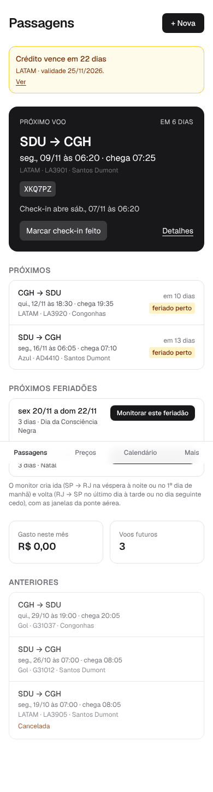            | 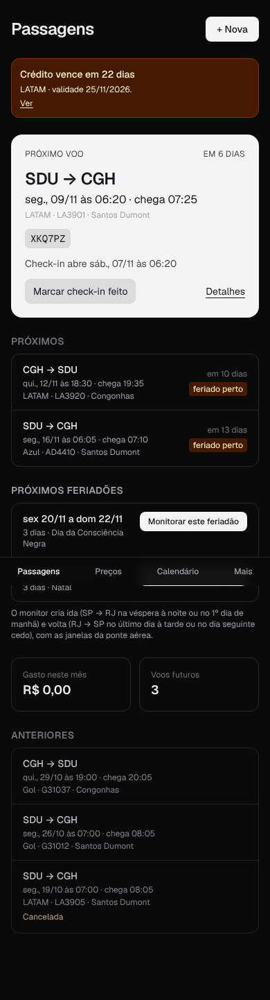       | 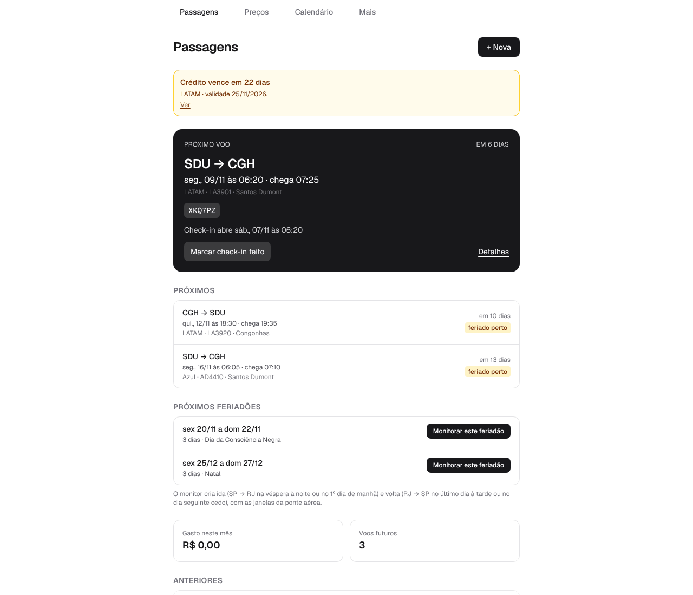     |
| 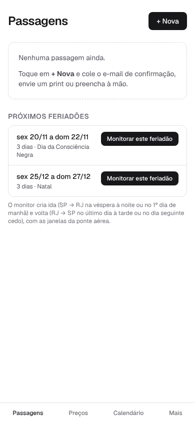                       | 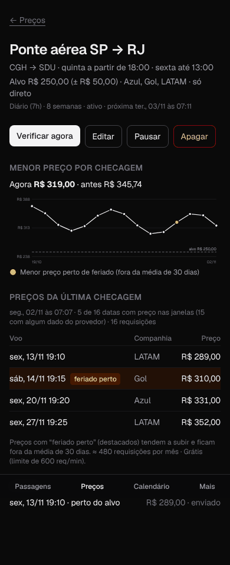   | 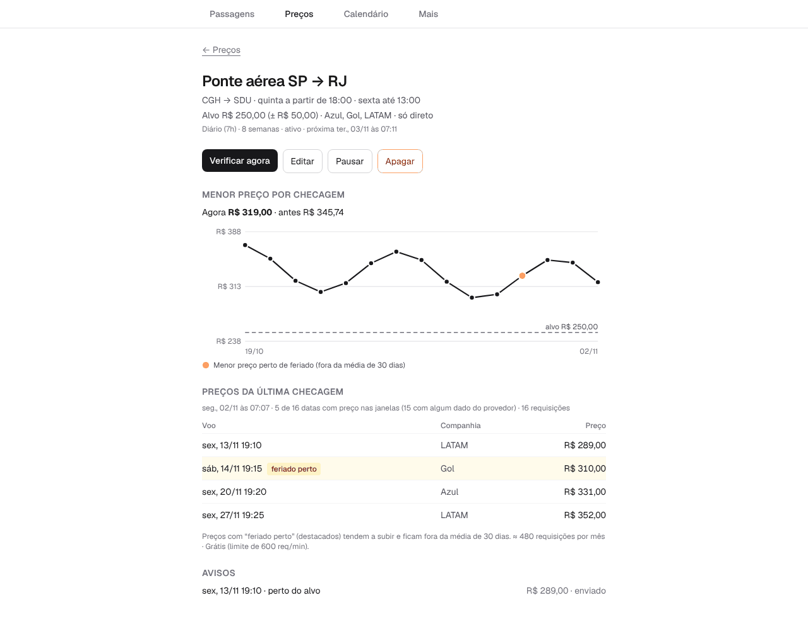 |
| 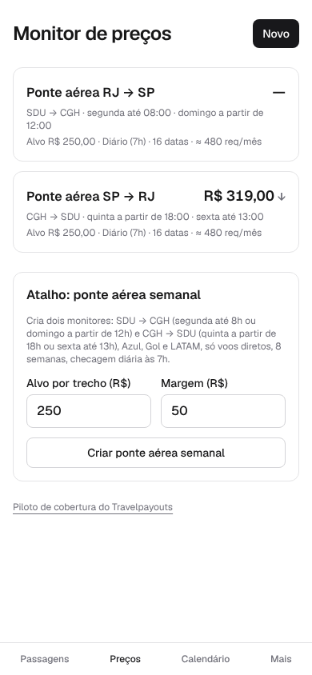            | 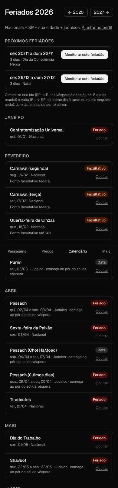     | 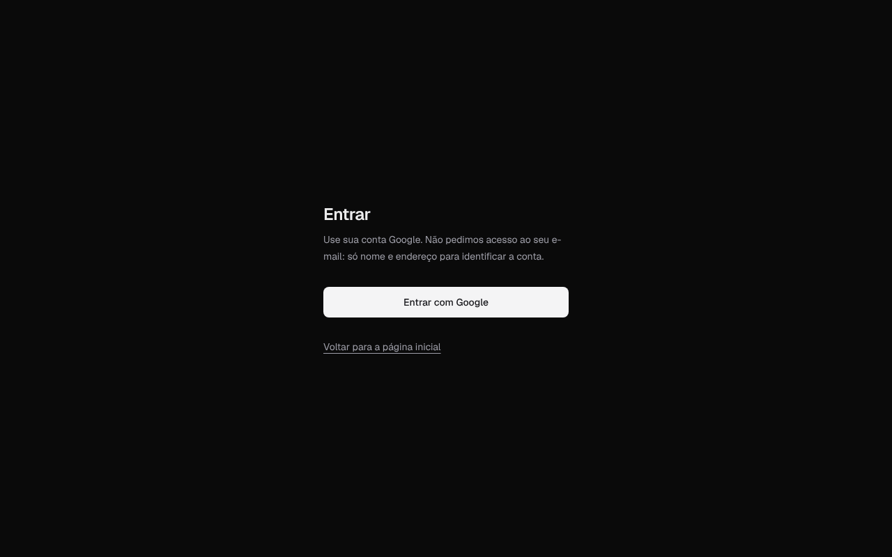             |
| 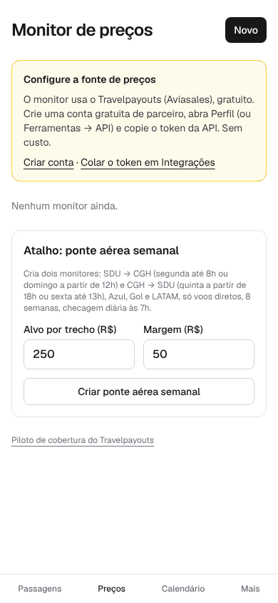                 | 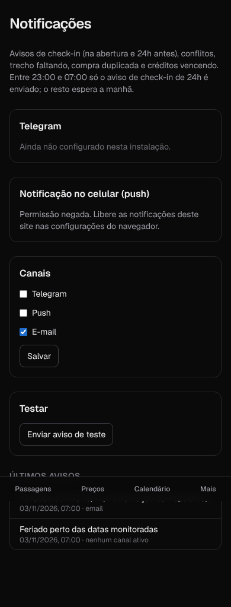 | 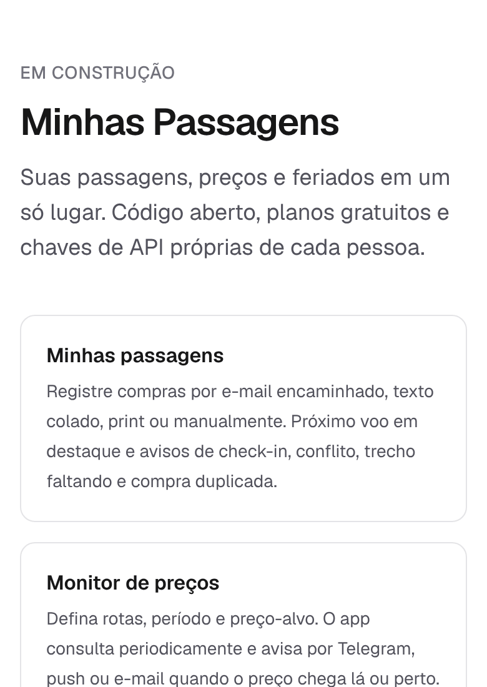            |
| 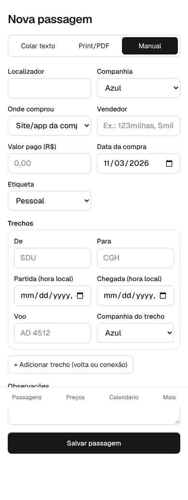 |                  | 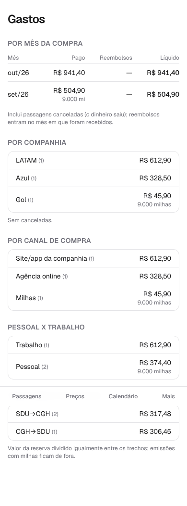                    |

Nos prints em página inteira, a barra inferior (fixa) aparece no meio. No aparelho, ela fica no rodapé e não cobre conteúdo (medido: último elemento em 748 px, barra em 803 px).

**O que funciona:** a hierarquia da tela inicial (o próximo voo em destaque, o localizador em caixa), os textos curtos e em bom português, os estados vazios com instrução e a densidade da lista de preços.

**O que falta:** personalidade, contraste no escuro, ícones na navegação, estados de erro e carregamento, roteiro de primeira vez e uso do espaço no desktop.

### 8.2 Direção visual proposta: "cartão de embarque"

A ideia central: o app é a sua pasta de viagens, e a peça principal é o **cartão do próximo voo desenhado como cartão de embarque**. O resto da interface fica sóbria para ele se destacar.

- **Cartão do próximo voo:** à esquerda, as cidades grandes (`SDU → CGH`) com códigos IATA em fonte mono. À direita, um canhoto destacado por uma linha picotada com o localizador, o portão e o check-in. O fundo usa a cor da marca, não preto. A contagem "em 6 dias" vira uma pílula. Com check-in aberto, o canhoto fica verde e mostra "Fazer check-in na LATAM ↗".
- **Tipografia:** Geist para a interface e **Geist Mono com números tabulares** para localizador, voos, horários e preços (as colunas de R$ se alinham). Escala de 5 tamanhos (12/14/16/20/28) no lugar dos 9 atuais.
- **Ícones:** um conjunto só (Lucide, MIT): avião para Passagens, gráfico em queda para Preços, calendário e "mais".
- **Navegação no celular:** barra inferior com ícone e rótulo, 56 px de altura mais a área segura do iPhone, item ativo com pílula da cor da marca e "Mais" ativo nas telas de perfil, integrações e notificações.
- **Navegação no desktop (≥ 1024 px):** trilho lateral e duas colunas (lista à esquerda, detalhe à direita), em vez de uma coluna de 640 px no centro.
- **Componentes base:** `Card`, `Button` (primário, secundário, perigo), `Badge` (feriado perto, facultativo, cancelada), `Field` (rótulo sempre visível) e `EmptyState`. Hoje cada tela repete classes Tailwind.
- **Gráfico de preços:** linha da cor da marca, faixa do alvo em verde-claro, pontos perto de feriado em âmbar, eixos de 12 px e valor ao tocar.

### 8.3 Tokens de cor (contraste conferido, WCAG AA ≥ 4,5:1)

| Token                       | Claro                        | Escuro                                        | Contraste (texto / fundo)                              |
| --------------------------- | ---------------------------- | --------------------------------------------- | ------------------------------------------------------ |
| `--bg`                      | `#F6F5F1` (papel)            | `#0E1116`                                     | —                                                      |
| `--card`                    | `#FFFFFF`                    | `#171B22`                                     | —                                                      |
| `--text`                    | `#14161A`                    | `#ECEDEF`                                     | 16,6 / 16,1                                            |
| `--text-muted`              | `#5B606B`                    | `#A3A9B5`                                     | 6,3 no cartão / 7,3 no cartão                          |
| `--brand` (anil)            | `#1E4FD8`                    | `#8FB0FF`                                     | 6,6 (branco sobre a marca) / 8,9 (fundo sobre a marca) |
| `--warn` (feriado, crédito) | `#8A4B00` sobre `#FDF1D8`    | `#F5C26B` sobre `#2A2110`                     | 6,1 / 9,7                                              |
| `--ok` / `--danger`         | `#11703F` / `#B42318`        | claros equivalentes                           | 6,2 / 6,6                                              |
| Atual (referência)          | `zinc-500` sobre branco: 4,8 | `zinc-500` sobre `#0A0A0A`: **4,1 (reprova)** | —                                                      |

Os tokens entram em `globals.css` via `@theme` do Tailwind 4 (`--color-brand` etc.) e substituem `zinc-*` e `dark:` espalhados.

### 8.4 Estados e roteiros, com exemplos concretos

- **Primeira vez (`/app` vazio):** cartão "Comece por aqui" com 4 passos e marca de feito:
  1. "Conectar seu Gmail para achar suas passagens" (ou "Colar um e-mail de confirmação");
  2. "Chave da Anthropic, para ler e-mails e prints (~US$ 0,01 por passagem)";
  3. "Avisos por e-mail (Resend, grátis)";
  4. "Monitor da ponte aérea".

  Cada passo leva direto à tela certa. Quando falta uma chave, o botão diz o que falta ("Configurar chave para ler com IA") em vez de sumir.

- **Carregamento:** `loading.tsx` com esqueleto do cartão de embarque e de 3 linhas da lista. Nada de tela branca.
- **Erro:** `error.tsx`: "Não conseguimos carregar suas passagens agora. Isso costuma passar em alguns segundos." + [Tentar de novo] + [Ver status], com o id do erro para o log (E1).
- **404:** "Esta página não existe (ou a passagem foi apagada)." + [Voltar para Passagens].
- **Offline (PWA):** "Sem conexão. Seu próximo voo: SDU → CGH, seg 09/11 06:20, localizador XKQ7PZ." Útil de verdade na fila do embarque.
- **Monitor sem preço na janela:** "Nenhum voo entre 18h e 23h59 com preço conhecido. 5 das 16 datas têm preço fora da janela. [Ver fora da janela]".

## 9. Fontes da pesquisa (consultadas em 03/11/2026, via busca)

- Gmail: escopos (developers.google.com/workspace/gmail/api/auth/scopes), escopos restritos (support.google.com/cloud/answer/13464325), quando a verificação não é necessária (support.google.com/cloud/answer/13464323), apps não verificados (support.google.com/cloud/answer/7454865), OAuth 2.0 e expiração em 7 dias no status Testing (developers.google.com/identity/protocols/oauth2), `messages.list` e `includeSpamTrash` (developers.google.com/workspace/gmail/api/v1/reference/users/messages/list), sincronização (…/gmail/api/guides/sync), cotas (developers.google.com/gmail/api/reference/quota), push (…/gmail/api/guides/push), extensões IMAP e `X-GM-RAW` (developers.google.com/workspace/gmail/imap/imap-extensions), senhas de app (support.google.com/mail/answer/185833), encaminhamento (support.google.com/mail/answer/10957).
- CASA, custo (terceiros): deepstrike.io/blog/google-casa-security-assessment-2025. `in:anywhere` (terceiros): mailmeteor.com/blog/gmail-search-operators.
- Microsoft: learn.microsoft.com/entra/identity-platform/application-consent-experience.
- Preços: serpapi.com/google-flights-api, preços da SerpApi (terceiros: costbench.com, apiserpent.com), processo Google × SerpApi (gigazine.net, 22/12/2025), Travelpayouts (support.travelpayouts.com/hc/en-us/articles/203956163 e /4402565416594), Duffel (help.duffel.com, artigo "What is Excess Search"; duffel.com/guides/getting-started), Ignav (ignav.com/docs/faq), encerramento do Amadeus (phocuswire.com).
- Anthropic: tabela de preços da skill oficial `claude-api` (Haiku 5.5 US$ 0,10/0,50; Sonnet 5.5 US$ 2/10) e platform.claude.com/docs/en/build-with-claude/batch-processing.
- Planos: resend.com/docs/knowledge-base/resend-email-quota, vercel.com/docs/plans/hobby, vercel.com/docs/limits.
- A leitura direta das páginas (WebFetch) ficou bloqueada pela rede desta sessão. Os números foram lidos nos resumos da busca e precisam ser reconfirmados ao criar cada conta.

## 10. Roteiro proposto

| Bloco                                        | Tamanho                        | Conteúdo                                                                                                                                                                                                                                                                                                                                                                                                                                                                                              | Achados                                                     |
| -------------------------------------------- | ------------------------------ | ----------------------------------------------------------------------------------------------------------------------------------------------------------------------------------------------------------------------------------------------------------------------------------------------------------------------------------------------------------------------------------------------------------------------------------------------------------------------------------------------------- | ----------------------------------------------------------- |
| **0. Ganhos rápidos**                        | ~2 dias (cada item ≤ 1 dia)    | Aviso só registra se entregue + nova tentativa; try/catch por usuário + timeouts + CHECK de fuso; editar passagem sem recriar trechos; `CRON_SECRET` obrigatório + trava atômica do vigia; exportação completa; textos honestos (retenção, "e-mail encaminhado", README e STATUS); cabeçalhos de segurança básicos; `error`/`not-found`/`loading` em pt-BR; `connection()` no `getOptionalUser`; contraste e rótulos do axe; alerta "volta não comprada"; `success:false` do Travelpayouts como falha | A1, A2, A3, A6, D1, D2, F11, E7, S2, F4, F1, F2, F3, X3, P2 |
| **1. Fonte de preços** (em paralelo com o 2) | Médio (1–2 dias + 7 de piloto) | Piloto grátis SerpApi (2 semanas à frente, 240/mês) e Ignav (adaptador novo), mesma tela de piloto, decisão em ~16/11. Fonte híbrida SerpApi + Travelpayouts. Orçamento de tempo do tick e reserva do monitor                                                                                                                                                                                                                                                                                         | P1, P3, A4, X2                                              |
| **2. Importação do Gmail (v1, só você)**     | Grande (5–8 dias)              | Teste do token de 8 dias → "Conectar Gmail" → busca + pré-filtro + extração em lote → tela de revisão → deduplicação e remarcações → histórico nos gastos → sincronização a cada 30 min pelo `pg_cron`. Inclui BYOK v2 com AAD (o token do Google é o segredo mais sensível do app)                                                                                                                                                                                                                   | X1, S4, D2                                                  |
| **3. Visual e primeira vez**                 | Médio a grande (3–5 dias)      | Tokens e componentes base, cartão de embarque, navegação com ícones e trilho no desktop, "Comece por aqui", gráfico legível, calendário no mês atual, PWA offline do próximo voo                                                                                                                                                                                                                                                                                                                      | F5, F6, F7, F9, F10, P4                                     |
| **4. Robustez e visibilidade**               | Médio (2–3 dias)               | `instrumentation.ts` + `job_runs` + tela "Sistema"; reservar antes de enviar; avisos agrupados num e-mail; vigia com fallback por variáveis; alerta de backup velho + restauração de teste; workflows com env mínimo                                                                                                                                                                                                                                                                                  | E1, A5, A7, A8, A9, A10, D3, S1, S7                         |
| **5. Testes e tipos**                        | Médio (2–3 dias)               | Testes do tick e dos repositórios com Supabase falso; RLS com `supabase start` no CI; tipos gerados; helper `localToday`; colunas compartilhadas                                                                                                                                                                                                                                                                                                                                                      | E2, E4, E5, E6, D5, D6                                      |
| **6. Antes de abrir para outras pessoas**    | Grande                         | Lista de permitidos ou convite; limites por usuário; tick paginado; M7 (domínio + encaminhamento) e importação .mbox para quem não é o dono; rotação da chave mestra; revisar o termo "não comercial" da Vercel                                                                                                                                                                                                                                                                                       | D4, E3, S3, X5                                              |

**Ordem recomendada:** 0 → (1 em paralelo com 2) → 3 → 4 → 5 → 6.

- O Bloco 0 tira os riscos que já se manifestaram.
- O 1 e o 2 completam o objetivo da entrevista: passagens com dados reais e um monitor que avisa de verdade.
- O 3 é a vitrine para o LinkedIn (M9).
- O 4 e o 5 deixam tudo sustentável.
- O 6 só acontece se você decidir abrir para outros.

## 11. Decisões que dependem de você

1. **Fonte de preços:** posso montar o piloto grátis da SerpApi (e do Ignav) com chaves suas? Se ele passar, aceita a fonte híbrida dentro do grátis, ou prefere o Starter de US$ 25/mês (acima do teto de R$ 50)?
2. **Gmail:** aprova a opção A (Gmail API `gmail.readonly`, projeto Google seu, uso pessoal sem verificação, sem guardar o corpo dos e-mails), com IMAP + senha de app como plano B se o token expirar em 7 dias?
3. **Cadastro:** a 2ª conta é sua? Fecho o cadastro na v1 (só e-mails permitidos) ou mantenho aberto?
